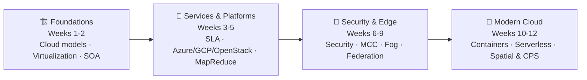
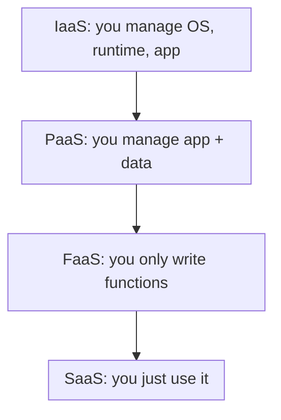
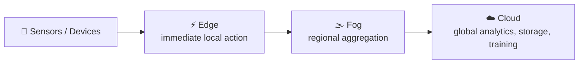

<div align="center">

# ☁️ NPTEL Cloud Computing
### Complete Assignment Solutions · Weeks 1 – 12

**IIT Kharagpur · NPTEL Online Certification**


*Every question. Every answer. Every explanation, in one place.* 🚀

[📊 Answer Key](#-quick-answer-key) · [📖 Week-by-Week](#-week-by-week-breakdown) · [🧮 Formulas](#-worked-calculations) · [🧠 Cheat Sheet](#-cloud-computing-cheat-sheet) · [🚀 Get Started](#-getting-started)

</div>

---

## 📌 About

This repository contains solved **weekly assignments for the NPTEL Cloud Computing course (IIT Kharagpur)**. Each assignment has **10 MCQ/MSQ questions (10 marks)**, and every answer comes with a clear reason so you learn the *why*, not just the *what*.

| 📦 What you get | 🔢 Count |
|---|:---:|
| Weekly assignments | **12** |
| Questions solved | **120** |
| Detailed explanations | **120** |
| Numerical problems with formulas | **8** |
| Cloud topics covered | **60+** |

> ⚠️ **Heads-up:** Use this for **revision and learning**. Question banks can change between sessions, so attempt each week yourself first, then compare. This is an unofficial community resource and not affiliated with NPTEL or IIT Kharagpur.

---

## 🧭 Course Roadmap



---

## 📊 Quick Answer Key

> 💡 Cover the table, try the week, then check yourself.

| Week | Q1 | Q2 | Q3 | Q4 | Q5 | Q6 | Q7 | Q8 | Q9 | Q10 |
|:----:|:--:|:--:|:--:|:--:|:--:|:--:|:--:|:--:|:--:|:---:|
| **1**  | B | C | D | B | A | C | B | A | B | B |
| **2**  | C | B | B | C | B | D | B | A | B | A |
| **3**  | B | D | C | A | A | B | C | B | B | B |
| **4**  | C | B | C | C | C | C | C | B | A | B |
| **5**  | A | C | B | B | B | B | C | B | A | A |
| **6**  | B | D | C | C | B | C | B | C | A | B |
| **7**  | C | B | B | B | B | B | C | A | B | B |
| **8**  | B | A | B | B | C | B | B | B | A | A |
| **9**  | B | C | A | D | B | C | B | A | A | C |
| **10** | B | C | B | C | B | B | B | B | B | C |
| **11** | B | C | B | B | B | C | B | B | B | A |
| **12** | A | B | B | B | A | B | B | C | B | A |

---

## 📖 Week-by-Week Breakdown

Click a week to expand its answers and the concept behind each one.

<details>
<summary><b>🟦 Week 1 · Cloud Fundamentals, Virtualization & Distributed Systems</b></summary>

| Q | Ans | Concept |
|:-:|:---:|---------|
| 1 | **B** | Resource pooling: resources are dynamically shared among multiple customers |
| 2 | **C** | EC2 with self-managed OS is **IaaS** |
| 3 | **D** | **Private cloud** is for exclusive use by one organization |
| 4 | **B** | VMs on one machine can run different operating systems |
| 5 | **A** | Distributed systems add scalability and fault tolerance, but not guaranteed lower latency |
| 6 | **C** | **XaaS**: anything or everything as a service |
| 7 | **B** | Type-2 hypervisor runs as an application on a host OS |
| 8 | **A** | PaaS: focus on development, automatic platform updates, faster deployment |
| 9 | **B** | Amazon EC2 is IaaS |
| 10 | **B** | **Grid**: dispersed, heterogeneous, loosely coupled, multi-domain |

</details>

<details>
<summary><b>🟦 Week 2 · Virtualization Types, Web Services & SOA</b></summary>

| Q | Ans | Concept |
|:-:|:---:|---------|
| 1 | **C** | **Para-virtualization**: guest OS uses hypercalls |
| 2 | **B** | Full virtualization: unmodified guest OS, with the hypervisor and CPU extensions handling privileged instructions |
| 3 | **B** | Public cloud: open to the public, owned and operated by the CSP |
| 4 | **C** | **DOM** gives random access and modification |
| 5 | **B** | Hypervisor manages VMs, and the host OS is what a Type-2 hypervisor runs on |
| 6 | **D** | SLAs, compliance and latency should all be evaluated |
| 7 | **B** | **WSDL** describes a web service interface |
| 8 | **A** | SOAP: platform independence, XML, UDDI discovery, with no latency guarantee |
| 9 | **B** | Web services don't solve ultra-low-latency communication |
| 10 | **A** | SOA: Publish → Find → Bind |

</details>

<details>
<summary><b>🟦 Week 3 · SLAs, Parallel Databases, Streaming & MapReduce</b></summary>

| Q | Ans | Concept |
|:-:|:---:|---------|
| 1 | **B** | SLAs don't specify encryption algorithms or key storage procedures |
| 2 | **D** | Multilevel SLA: Corporate, Customer and Service levels |
| 3 | **C** | The service-level SLA is the most specific and binding |
| 4 | **A** | Availability % and MTTR quantify reliability and recoverability |
| 5 | **A** | 0.001 × 720 h = **0.72 h** |
| 6 | **B** | Distributed query execution across nodes |
| 7 | **C** | A nightly batch job is least suitable for real-time fraud detection |
| 8 | **B** | **Object storage** (S3 or GCS) for petabytes of data used with Spark |
| 9 | **B** | Configure a **combiner** to shrink intermediate data |
| 10 | **B** | 640 × 5 = **3200** vCPUs |

</details>

<details>
<summary><b>🟦 Week 4 · Azure, GCP & OpenStack Services</b></summary>

| Q | Ans | Concept |
|:-:|:---:|---------|
| 1 | **C** | Azure SQL **Hyperscale** separates compute and storage, up to 100 TB |
| 2 | **B** | Availability Zones are isolated from each other |
| 3 | **C** | **Premium (P1v3+)** supports the most deployment slots |
| 4 | **C** | **HTTPS Only** blocks unencrypted access |
| 5 | **C** | **Cloud Spanner**: relational, global consistency, horizontal scaling |
| 6 | **C** | **Cinder**: persistent block storage |
| 7 | **C** | GKE manages clusters, while Cloud Run is serverless containers |
| 8 | **B** | **Pub/Sub + BigQuery + Looker Studio** |
| 9 | **A** | `gcloud app services set-traffic default --splits=v3=1` |
| 10 | **B** | **Neutron**: OpenStack networking |

</details>

<details>
<summary><b>🟦 Week 5 · Energy, Elasticity, HDFS/MapReduce & Cost</b></summary>

| Q | Ans | Concept |
|:-:|:---:|---------|
| 1 | **A** | 1% × (12 × 30 h) = **3.6 h** |
| 2 | **C** | More active cores mean higher power consumption |
| 3 | **B** | **Pay-as-you-go** avoids upfront hardware costs |
| 4 | **B** | ⌈700 / 128⌉ = **6** map tasks |
| 5 | **B** | The **hypervisor** creates and manages VMs |
| 6 | **B** | The **Partitioner** routes keys to reducers |
| 7 | **C** | The **Combiner** is optional and may run zero or more times |
| 8 | **B** | **Energy-aware scheduling** consolidates VMs and powers off idle hosts |
| 9 | **A** | Both statements about elasticity are true |
| 10 | **A** | 2.8 < 225/75 = 3, so the cloud is cheaper |

</details>

<details>
<summary><b>🟦 Week 6 · Cloud Security</b></summary>

| Q | Ans | Concept |
|:-:|:---:|---------|
| 1 | **B** | Accidental modification breaks **integrity** |
| 2 | **D** | A fake portal compromises **authenticity** |
| 3 | **C** | **Session hijacking** is an active attack |
| 4 | **C** | **Eavesdropping** is passive, so it can't modify data |
| 5 | **B** | DoS: flooding a server so it becomes unavailable |
| 6 | **C** | Exploiting a vulnerability is not reconnaissance |
| 7 | **B** | Authentication verifies who you are, authorization decides what you can do |
| 8 | **C** | Full OS-level control with no hardware to manage means **IaaS** |
| 9 | **A** | **Data location** concern |
| 10 | **B** | Open standards and portability reduce vendor lock-in |

</details>

<details>
<summary><b>🟦 Week 7 · Mobile Cloud, Fog & Geospatial Computing</b></summary>

| Q | Ans | Concept |
|:-:|:---:|---------|
| 1 | **C** | Millisecond-critical tasks shouldn't be offloaded to a remote cloud |
| 2 | **B** | **Rapid elasticity** |
| 3 | **B** | Offloading optimizes time, energy and resource utilization |
| 4 | **B** | A nearby **cloudlet** for AR under 20 ms |
| 5 | **B** | **Data confidentiality** |
| 6 | **B** | Fog reduces latency caused by distant data centers |
| 7 | **C** | Fog nodes do *not* permanently store all enterprise data |
| 8 | **A** | Both statements are true, and Statement 2 explains Statement 1 |
| 9 | **B** | **Boundary effects** between tiles |
| 10 | **B** | IoT → **Fog/Edge** → Cloud |

</details>

<details>
<summary><b>🟦 Week 8 · Docker, Kubernetes, Hypervisors & Sensor Cloud</b></summary>

| Q | Ans | Concept |
|:-:|:---:|---------|
| 1 | **B** | `docker rmi` removes images |
| 2 | **A** | `docker network ls` lists networks |
| 3 | **B** | Containers share the host kernel, while VMs run separate guest kernels |
| 4 | **B** | **etcd** stores cluster state |
| 5 | **C** | **VirtualBox** is a Type-2 hypervisor |
| 6 | **B** | VM consolidation plus low-power idle servers |
| 7 | **B** | Middleware abstracts heterogeneous sensors |
| 8 | **B** | IoT → Edge/Fog → Cloud |
| 9 | **A** | **Encryption** protects data in transit |
| 10 | **A** | Edge reduces latency but doesn't eliminate it |

</details>

<details>
<summary><b>🟦 Week 9 · Edge–Fog–Cloud & Cloud Federation</b></summary>

| Q | Ans | Concept |
|:-:|:---:|---------|
| 1 | **B** | Machine-level work at the edge, plant-level work at fog |
| 2 | **C** | **Edge–Fog–Cloud** architecture |
| 3 | **A** | Edge sends the least data to the cloud, and cloud-only sends the most |
| 4 | **D** | **Vertical scalability** adds RAM or CPU to the same node |
| 5 | **B** | Edge acts locally, Fog coordinates regionally, Cloud orchestrates globally |
| 6 | **C** | First stage at the edge, training in the cloud |
| 7 | **B** | **Service migration** and task continuity during handover |
| 8 | **A** | Resource federation across providers |
| 9 | **A** | Independent providers have differing security and reliability policies |
| 10 | **C** | Hybrid: private control plus public scalability |

</details>

<details>
<summary><b>🟦 Week 10 · Live Migration, Containers & Kubernetes</b></summary>

| Q | Ans | Concept |
|:-:|:---:|---------|
| 1 | **B** | A high page-dirtying rate increases migration time |
| 2 | **C** | **Post-copy** migration |
| 3 | **B** | Compression and deduplication reduce transferred data |
| 4 | **C** | **Load balancing** across fog nodes |
| 5 | **B** | **kube-scheduler** assigns Pods to nodes |
| 6 | **B** | `docker build` produces an **image** |
| 7 | **B** | Namespaces isolate, cgroups limit resources |
| 8 | **B** | 32768 MB ÷ 16 MB/s = 2048 s ≈ **34 min** |
| 9 | **B** | Data persists in the named volume |
| 10 | **C** | Containers share the host kernel, VMs virtualize a full machine |

</details>

<details>
<summary><b>🟦 Week 11 · Dew Computing & Serverless</b></summary>

| Q | Ans | Concept |
|:-:|:---:|---------|
| 1 | **B** | Dew computing: local independence, then sync when connected |
| 2 | **C** | **Dew computing** |
| 3 | **B** | Conflict detection and resolution during sync |
| 4 | **B** | Offline edits introduce data conflicts |
| 5 | **B** | **Cold start** |
| 6 | **C** | Statelessness enables scaling and parallelism |
| 7 | **B** | Lambda has a **15-minute** timeout |
| 8 | **B** | Horizontal scalability of function invocations |
| 9 | **B** | 40 min exceeds the 15 min limit |
| 10 | **A** | **Amazon Redshift** for large-scale analytics |

</details>

<details>
<summary><b>🟦 Week 12 · Mobile Cloud, Spatial Cloud, CPS, V2V & 5G</b></summary>

| Q | Ans | Concept |
|:-:|:---:|---------|
| 1 | **A** | MCC offloads compute, saves battery and provides storage, but can't guarantee zero latency |
| 2 | **B** | **Spatial Cloud Computing** |
| 3 | **B** | Flood-risk mapping is a geospatial task |
| 4 | **B** | **Closed-loop control** in CPS |
| 5 | **A** | **Spatial trajectory** |
| 6 | **B** | **Spatial crowdsourcing** |
| 7 | **B** | V2V: safety-critical information exchange |
| 8 | **C** | Integrated Edge–Fog–Cloud |
| 9 | **B** | Dynamic traffic signal optimization |
| 10 | **A** | **eMBB** for HD video and AR |

</details>

---

## 🧮 Worked Calculations

| 🔢 Problem | 🧪 Formula | ✅ Result |
|---|---|:---:|
| **SLA downtime** (W3 Q5) | `(1 − 0.999) × 720 h` | **0.72 h ≈ 43 min** |
| **SLA, partial-day workload** (W5 Q1) | `0.01 × (12 h × 30 days)` | **3.6 h** |
| **OpenStack overcommit** (W3 Q10) | `640 × 5` | **3200 vCPUs** |
| **HDFS map tasks** (W5 Q4) | `⌈700 / 128⌉` | **6 tasks** |
| **Cloud vs. owning** (W5 Q10) | `peak ÷ avg = 225 ÷ 75 = 3`, and `2.8 < 3` | **Cloud cheaper** |
| **Cold migration time** (W10 Q8) | `(32 × 2³⁰) / (16 × 2²⁰)` | **2048 s ≈ 34 min** |

---

## 🧠 Cloud Computing Cheat Sheet

### 🏛️ Service Models: who manages what?



| Model | Example | You manage |
|---|---|---|
| **IaaS** | Amazon EC2 | OS, runtime, apps |
| **PaaS** | App Engine, Azure App Service | Code and data |
| **FaaS** | AWS Lambda | Functions only |
| **SaaS** | Google Docs, Salesforce | Nothing |

### 🌐 Edge → Fog → Cloud



### ⚡ Rapid-fire facts

| Topic | Remember |
|---|---|
| **Hypervisors** | Type 1 = bare metal (ESXi, Xen, Hyper-V Server). Type 2 = hosted (VirtualBox). |
| **VM vs. Container** | VM = own guest kernel. Container = shared host kernel. |
| **Live migration** | Pre-copy sends memory, then switches. Post-copy switches, then fetches pages. |
| **Passive attacks** | Sniffing, eavesdropping, traffic analysis. |
| **Active attacks** | Hijacking, replay, MITM, masquerading, DoS. |
| **Scalability** | Vertical = bigger node. Horizontal = more nodes. |
| **Serverless** | Stateless, auto-scales, has cold starts, Lambda limit is 15 min. |
| **MapReduce** | Partitioner picks the reducer. Combiner is optional and local. |
| **OpenStack** | Nova = compute, Cinder = block storage, Swift = object storage, Neutron = networking, Keystone = identity. |
| **5G** | eMBB = bandwidth, URLLC = low latency, mMTC = massive IoT. |

---

## 🗂️ Repository Structure

```text
📦 nptel-cloud-computing
 ┣ 📜 README.md
 ┣ 📄 Assignment_1.pdf
 ┣ 📄 Assignment_2.pdf
 ┣ 📄 ...
 ┗ 📄 Assignment_12.pdf
```

Each PDF contains the question, its options, the **correct answer** and a **detailed solution**.

---

## 🚀 Getting Started

```bash
# 1. Clone the repo
git clone https://github.com/<your-username>/<repo-name>.git

# 2. Open it
cd <repo-name>
```

**Suggested study flow:** 📝 attempt the week → ✅ check the answer key → 📖 read the explanations → 🔁 revisit the cheat sheet.

---

## ❓ FAQ

<details>
<summary><b>Are the answers verified?</b></summary>
Yes. All 120 answers were cross-checked against the official solution PDFs.
</details>

<details>
<summary><b>Can I rely on this for future batches?</b></summary>
Questions can change between sessions. Use this to understand the concepts, and always attempt the live assignment yourself.
</details>

<details>
<summary><b>Found a mistake?</b></summary>
Open an issue or send a pull request. Corrections are very welcome.
</details>

---

## 🤝 Contributing

1. 🍴 Fork the repo
2. 🌿 Create a branch: `git checkout -b fix/week-x-typo`
3. 💾 Commit your changes
4. 📬 Open a Pull Request

---

<div align="center">

### ⭐ If this helped you, give it a star!

Made with ☕ for fellow NPTEL learners.

*All course content and questions belong to **NPTEL / IIT Kharagpur**. This repository is shared for educational purposes only.*

</div>
